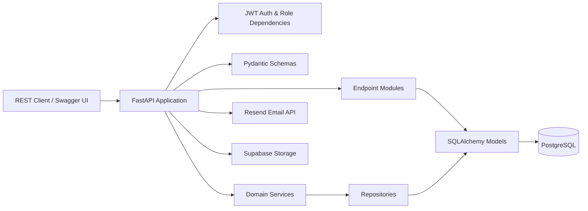
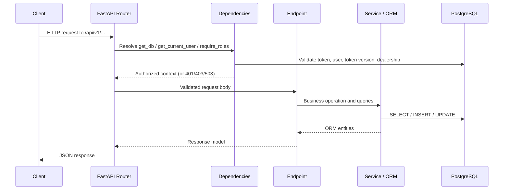

# Architecture

This document describes the backend architecture as implemented, including layering, component responsibilities, runtime behaviour, and cross-cutting concerns.

## High-level view



The application is a single FastAPI process. Requests are handled by endpoint modules, validated by Pydantic schemas, authorized by shared dependencies, and persisted through SQLAlchemy sessions.

## Technology stack

| Concern | Implementation |
| --- | --- |
| Web framework | FastAPI (ASGI), Uvicorn server |
| Validation/config | Pydantic v2, `pydantic-settings` |
| ORM | SQLAlchemy 2.0 declarative models |
| Database | PostgreSQL via `psycopg` (v3) |
| Password hashing | `pwdlib` recommended hasher (Argon2) |
| Tokens | PyJWT (HS256 by default) |
| HTTP client | `httpx` (also declared; email uses `urllib`) |
| Object storage | `supabase` Storage client |
| Email | Resend REST API over `urllib` |
| Testing | `pytest`, `pytest-asyncio`, FastAPI `TestClient` |
| Linting | `ruff` |

## Project layout

```text
backend/
├── app/
│   ├── main.py                 # FastAPI app, lifespan, root route
│   ├── api/v1/
│   │   ├── router.py           # Aggregates all v1 routers under /api/v1
│   │   └── endpoints/          # auth, dealerships, brands, vehicles,
│   │                           # staff, testdrive, health
│   ├── core/                   # Settings and Supabase client factory
│   ├── db/                     # Base, engine/session, startup migration
│   ├── dependencies/           # Current-user and role dependencies
│   ├── models/                 # SQLAlchemy models (user, workspace)
│   ├── repositories/           # User and dealership data access
│   ├── schemas/                # Pydantic request/response models
│   ├── services/               # Auth, dealership, sales agent, verification, slot holds
│   ├── adapters/               # Website, WhatsApp, Voice channel adapters
│   ├── orchestration/          # Central multi-channel orchestrator
│   └── tools/                  # Deterministic sales agent inventory/booking tools
├── seed/                       # Demo accounts and stable credentials
├── tests/                      # Integration and unit tests
├── requirements.txt
└── pytest.ini
frontend/                       # Next.js 15 Tailwind Dashboard
docs/                           # This documentation
```

## Layering

The intended layering is **routes → services → repositories → database**:

| Layer | Responsibility | Location |
| --- | --- | --- |
| Routes | HTTP contract, dependency wiring, status codes | `app/api/v1/endpoints/*` |
| Schemas | Input validation and response serialization | `app/schemas/*` |
| Services | Business rules and orchestration | `app/services/*` |
| Repositories | Database access for their aggregate | `app/repositories/*` |
| Models | Persistence mapping | `app/models/*` |
| Dependencies | Identity, roles, workspace checks | `app/dependencies/*` |
| Core | Settings and external client factories | `app/core/*` |

### Implementation note

The codebase currently follows this layering strictly for authentication and dealership registration (`auth_service`, `dealership_service`, `user_repository`, `dealership_repository`). Several newer endpoints (brands, vehicles, staff, test drives) contain SQLAlchemy queries directly in the endpoint module. The stated repository-only rule in `.agents/rules/agents.md` is therefore not yet fully applied across all modules. This is documented in [Roadmap & Limitations](roadmap.md) rather than described as complete.

## Application startup and lifespan

`app/main.py` defines an async lifespan context that runs on startup:

1. `Base.metadata.create_all(engine)` creates any missing tables.
2. `ensure_vehicle_brand_associations(engine)` runs an idempotent, PostgreSQL-specific migration:
   - Adds `vehicles.brand_id` if missing.
   - Creates the `ix_vehicles_brand_id` index.
   - Creates the partial unique brand index.
   - Backfills one brand per distinct `(dealership_id, lower(trim(make)))` from existing vehicles.
   - Backfills `vehicles.brand_id` and fails startup if any vehicle cannot be associated.
   - Adds the `fk_vehicles_brand_id_brands` foreign key.
   - Sets `vehicles.brand_id` to `NOT NULL`.
3. Creates the partial unique index `uq_test_drive_booking_active_customer`.
4. On shutdown, disposes the engine.

Because `create_all` and the migration run on every startup, the service is self-provisioning for schema changes handled here. There is no Alembic revision history in the repository even though `alembic` is listed in `requirements.txt`.

## Request lifecycle



## API composition

All versioned routes are aggregated in `app/api/v1/router.py` under the `/api/v1` prefix:

| Router | Prefix | Tag |
| --- | --- | --- |
| Auth | `/auth` | Authentication |
| Dealerships | `/dealerships` | Dealerships |
| Brands | `/dealerships/{dealership_id}/brands` | Brands |
| Vehicles | `/dealerships/{dealership_id}/vehicles` | Vehicles |
| Staff | `/dealerships/{dealership_id}/staff` | Staff |
| Test Drives | `/dealerships/{dealership_id}` | Test Drives |
| Health | `/health` | System |

A root route `GET /` reports API status. Interactive docs are served by FastAPI at `/docs` and `/redoc`.

## Data access and transactions

- Each request gets a short-lived SQLAlchemy `Session` from `get_db`, closed in a `finally` block.
- Sessions are configured with `autoflush=False`, `autocommit=False`, and `expire_on_commit=False`.
- The engine is configured with a connection pool whose size, overflow, timeout, recycle, and pre-ping behaviour are controlled by environment variables.
- When `DATABASE_SCHEMA` is set, the connection's `search_path` is set to that schema (used by the test suite to isolate `dealerdesk_test`).
- Multi-step writes (registration, invitations, bookings) call `commit` once and `rollback` on `IntegrityError`.
- Concurrency-sensitive operations (slot booking/cancellation, settings reconciliation, last-admin checks) use `SELECT ... FOR UPDATE` row locks.

## Cross-cutting concerns

### Authentication and authorization
Bearer JWT access tokens are validated in `dependencies/auth.py`; role and dealership checks live in `dependencies/workspace.py`. Details are in [Authentication](authentication.md).

### Dealership isolation
Protected dealership routes call an access helper that returns `404` when `current_user.dealership_id` does not match the path `dealership_id`. This avoids leaking the existence of other dealerships' resources.

### Soft deletion and history
- Brands use `is_deleted` (archive) plus `is_active` (availability) flags.
- Vehicles are never hard-deleted; deletion clears `is_available` and `test_drive_enabled`.
- Dealerships are soft-deactivated via `is_active`.
- Users are soft-deactivated via `is_active`.

### Timezone handling for scheduling
Dealerships store an IANA timezone. Slot generation converts local opening/closing times to UTC using `zoneinfo`, and skips wall-clock times that do not exist during DST transitions.

### External integrations
- **Supabase Storage** (`core/supabase.py`) is lazily constructed and raises `RuntimeError` when unconfigured, which endpoints surface as `503`.
- **Resend email** (`services/email_service.py`) is optional. Without an API key it returns `email_provider_pending` instead of failing.

### Error handling
Errors use FastAPI's standard `{"detail": "..."}` JSON shape with appropriate status codes (`400`, `401`, `403`, `404`, `409`, `413`, `415`, `422`, `502`, `503`). There is no custom global exception envelope.

## Related documents

- [Data Model](data-model.md)
- [Authentication](authentication.md)
- [API Reference](api-reference.md)
- [Deployment](deployment.md)
