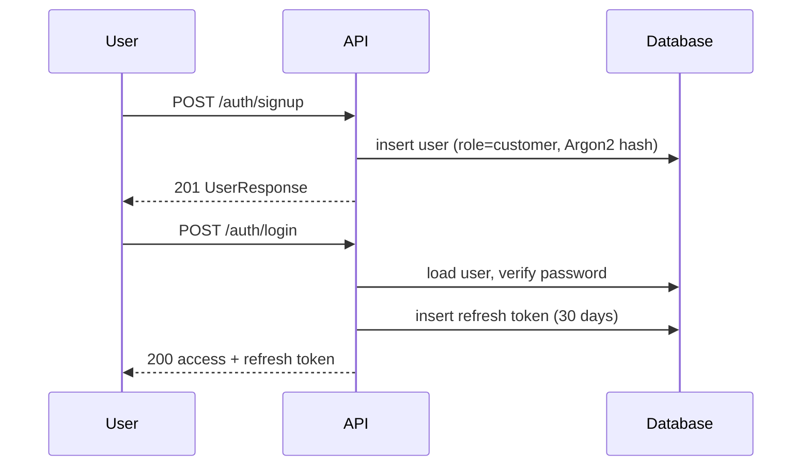
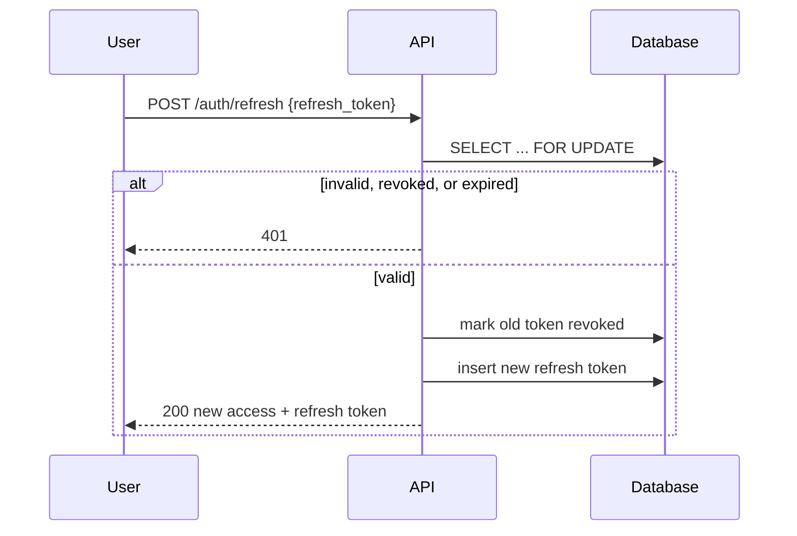

# Authentication and Authorization

DealerDesk uses email/password authentication with JWT access tokens, rotating refresh tokens, and role-based authorization scoped to a dealership workspace.

## Prerequisites

- `JWT_SECRET_KEY` must be configured. Without it, token issuance and validation return `503 Service Unavailable` with the configuration error message.
- Passwords are hashed with Argon2 via `pwdlib.PasswordHash.recommended()`.

## Roles

| Role | Dealership-bound | Capabilities |
| --- | --- | --- |
| `dealerdesk_admin` | No | Platform superadmin with unrestricted cross-dealership management, platform-wide workspace listing, and full access to any dealership workspace. |
| `customer` | No | Read active dealerships, inventory, and slots; book, reschedule, and cancel own test drives; manage own profile. |
| `dealership_admin` | Yes | Everything for one dealership, including staff, settings, dealership profile, and all bookings. |
| `manager` | Yes | Manage brands, inventory, view staff, invitations, and manage test-drive bookings. Cannot change dealership settings or staff roles. |
| `sales_rep` | Yes | Create/update vehicles, toggle availability, and view/manage test-drive bookings. |

Authorization is enforced server-side with two dependencies:

- `get_current_user` (`app/dependencies/auth.py`) — validates the bearer token and loads an active user.
- `require_roles(*roles)` (`app/dependencies/workspace.py`) — checks the user's role, that the user belongs to a dealership, and that the dealership is active.

Dealership-scoped endpoints additionally verify that the path `dealership_id` matches the caller's `dealership_id`; mismatches return `404` to avoid disclosing other workspaces.

## Token model

| Token | Format | Lifetime | Storage | Rotation |
| --- | --- | --- | --- | --- |
| Access | JWT (`HS256` by default) | `ACCESS_TOKEN_EXPIRE_MINUTES` (default 30) | Client | Replaced on refresh |
| Refresh | Random URL-safe string (48 bytes) | 30 days | `refresh_tokens` table | Single use; rotated on refresh |

### Access token claims

```json
{
  "sub": "42",
  "exp": 1790000000,
  "ver": 3
}
```

- `sub` — user id.
- `exp` — expiry timestamp.
- `ver` — user's token version at issue time.

### Validation

Every protected request runs these checks:

1. Decode the JWT with the configured secret and algorithm.
2. Reject missing/invalid subject or version (`401`).
3. Reject tokens present in `revoked_access_tokens` (by SHA-256 hash) (`401 Token revoked`).
4. Reject tokens whose `ver` differs from `user_token_versions.version` (`401 Token revoked`).
5. Reject missing, inactive, or deleted users (`401`).

## Session flows

### Registration and login



### Refresh rotation



Reusing a rotated refresh token returns `401`, because the stored row is already revoked.

### Logout

`POST /auth/logout`:

1. Purges expired rows from `revoked_access_tokens`.
2. Inserts the SHA-256 hash of the current access token with its expiry.
3. Revokes all of the user's refresh tokens.
4. Returns `204`.

The current access token fails immediately on subsequent use.

### Global invalidation

`user_token_versions` allows invalidating **all** outstanding access tokens at once by incrementing the version. This happens on:

- Password change
- Password reset
- Invitation activation
- Staff deactivation/removal
- Invitation revocation
- Account deletion

Refresh tokens are also revoked in these flows.

## Password and account flows

| Flow | Endpoint | Behaviour |
| --- | --- | --- |
| Change password | `POST /auth/change-password` | Verifies current password; new password must differ; revokes sessions. |
| Request reset | `POST /auth/request-password-reset` | Creates a one-hour token and emails it. Always returns a generic message. Token is deleted if delivery fails. |
| Confirm reset | `POST /auth/reset-password` | Consumes token, updates password, clears `must_change_password`, revokes sessions. |
| Activate invitation | `POST /auth/activate-invitation` | Consumes a valid invitation token, sets password, marks invitation accepted, revokes sessions. |
| Delete account | `DELETE /auth/me` | Soft-deactivates; revokes sessions; refuses if the user is the last active admin of a dealership. |
| Update profile | `PATCH /auth/me` | Updates name/email with case-insensitive email uniqueness. |

Password reset and change require 8–128 characters. Invitation activation tokens and reset tokens are 32–128 characters.

## Staff invitations

- Only `dealership_admin` can invite staff.
- Invited roles are `manager` or `sales_rep`.
- A temporary password is generated and a two-day activation token is stored on `staff_invitations`.
- If the email already belongs to a customer or another dealership, invitation fails with `409`.
- Re-inviting an existing pending/revoked/expired staff account reuses the invitation row, rotates the activation token, and invalidates old sessions.
- Accepted invitations cannot be revoked.
- Only one active invitation record exists per invited user (`user_id` is unique on `staff_invitations`).

The email content includes the temporary password and activation token. Delivery status (`email_sent`, `email_provider_pending`, `email_delivery_failed`) is returned in the invitation response.

## Guard rails

- A dealership must always retain at least one active `dealership_admin`. Removing, demoting, deactivating, or self-deleting the last one returns `409`.
- A dealership admin cannot remove themselves via the staff endpoint (`400`).
- Inactive or deleted dealerships block all workspace routes (`403` for role dependencies, `404` for scoped reads).

## Demo accounts

The backend includes idempotent demo accounts for local development and verification:
- **Platform Superadmin (`dealerdesk_admin`)**: `dealerdesk@demo.com` / `adminadmin`
- **Dealership Admin (`dealership_admin`)**: `dealership@demo.com` / `adminpassword`
- **Customer (`customer`)**: `customer@demo.com` / `customerpassword`

## Security notes

- Access tokens are stateless JWTs; revocation relies on the deny-list and version check.
- Refresh/reset/activation tokens are high-entropy random strings stored in plaintext in the database.
- The default JWT algorithm is `HS256`; keep the secret long, random, and out of source control.
- CORS middleware is implemented and configured via `CORS_ORIGINS`.
- Rate limiting, account lockout, and email verification remain future enhancements. See [Roadmap & Limitations](roadmap.md).

## Related documents

- [API Reference](api-reference.md) — request/response shapes.
- [Configuration](configuration.md) — JWT and email settings.
- [Data Model](data-model.md) — token tables.
