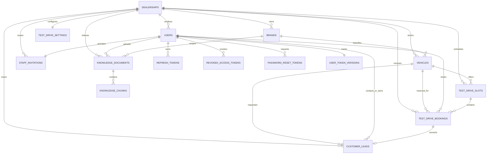

# Data Model

The persistence model is defined by SQLAlchemy declarative models in `app/models/user.py` and `app/models/workspace.py`. Tables live in the PostgreSQL schema selected by `DATABASE_SCHEMA` (or the connection default) and are evolved through Alembic migrations. Tests create isolated schemas from model metadata.

## Entity-relationship diagram

## Tables

### `users`

Application identities for customers and dealership staff.

| Column | Type | Constraints | Notes |
| --- | --- | --- | --- |
| `id` | integer | PK, indexed | |
| `dealership_id` | integer | FK → `dealerships.id`, nullable, indexed | `NULL` for customers and `dealerdesk_admin` |
| `name` | varchar(100) | not null | Display name |
| `email` | varchar(320) | unique, indexed | Lower-cased on write |
| `password` | varchar(255) | not null | Argon2 hash |
| `role` | varchar(32) | default `customer`, indexed | `customer`, `dealership_admin`, `manager`, `sales_rep`, `dealerdesk_admin` |
| `is_active` | boolean | default true | Soft-deactivation flag |
| `must_change_password` | boolean | default false | Set for invited staff |

### `refresh_tokens`

Single-use refresh tokens for sessions.

| Column | Type | Constraints | Notes |
| --- | --- | --- | --- |
| `id` | integer | PK | |
| `user_id` | integer | FK → `users.id`, indexed | |
| `token` | varchar(128) | unique, indexed | SHA-256 digest of the random URL-safe token |
| `expires_at` | timestamptz | not null | 30-day lifetime at issue |
| `revoked_at` | timestamptz | nullable | Set on rotation or logout |

### `revoked_access_tokens`

Deny-list of logged-out access tokens.

| Column | Type | Constraints | Notes |
| --- | --- | --- | --- |
| `id` | integer | PK | |
| `user_id` | integer | FK → `users.id`, indexed | |
| `token_hash` | varchar(64) | unique, indexed | SHA-256 of the JWT |
| `expires_at` | timestamptz | indexed | Token expiry; expired rows are purged on logout |

### `user_token_versions`

Per-user token version used to invalidate all outstanding access tokens.

| Column | Type | Constraints | Notes |
| --- | --- | --- | --- |
| `user_id` | integer | PK, FK → `users.id` | |
| `version` | integer | default 0 | JWT carries `ver`; mismatch ⇒ revoked |

### `password_reset_tokens`

| Column | Type | Constraints | Notes |
| --- | --- | --- | --- |
| `id` | integer | PK | |
| `user_id` | integer | FK → `users.id`, indexed | |
| `token` | varchar(128) | unique, indexed | SHA-256 digest; one-hour lifetime |
| `expires_at` | timestamptz | not null | |
| `used_at` | timestamptz | nullable | Single use |

### `dealerships`

| Column | Type | Constraints | Notes |
| --- | --- | --- | --- |
| `id` | integer | PK | |
| `name` | varchar(150) | not null | |
| `email` | varchar(320) | not null | Business email |
| `phone` | varchar(32) | nullable | |
| `address` | varchar(255) | nullable | |
| `timezone` | varchar(64) | default `UTC` | Validated IANA timezone |
| `is_active` | boolean | default true | Soft-deactivation |

### `staff_invitations`

| Column | Type | Constraints | Notes |
| --- | --- | --- | --- |
| `id` | integer | PK | |
| `dealership_id` | integer | FK → `dealerships.id`, indexed | |
| `invited_by_user_id` | integer | FK → `users.id` | Inviting admin |
| `user_id` | integer | FK → `users.id`, unique | One invitation record per user |
| `email` | varchar(320) | indexed | |
| `role` | varchar(32) | not null | `manager` or `sales_rep` |
| `activation_token` | varchar(128) | unique, indexed | SHA-256 digest; two-day lifetime |
| `expires_at` | timestamptz | not null | |
| `accepted_at` | timestamptz | nullable | |
| `revoked_at` | timestamptz | nullable | |

### `brands`

| Column | Type | Constraints | Notes |
| --- | --- | --- | --- |
| `id` | integer | PK | |
| `dealership_id` | integer | FK → `dealerships.id`, indexed | |
| `name` | varchar(100) | not null | Case-insensitive unique per dealership among non-deleted |
| `logo_path` | varchar(512) | nullable | Supabase object path |
| `logo_url` | varchar(1024) | nullable | Public URL |
| `is_active` | boolean | default true | Inactive brands are hidden from inventory |
| `is_deleted` | boolean | default false | Soft-delete/archive flag |

Index: `uq_brand_dealership_name_active` — unique on `(dealership_id, lower(name))` where `is_deleted = false`.

### `vehicles`

| Column | Type | Constraints | Notes |
| --- | --- | --- | --- |
| `id` | integer | PK | |
| `dealership_id` | integer | FK → `dealerships.id`, indexed | |
| `brand_id` | integer | FK → `brands.id` (`RESTRICT`), indexed, not null | Enforced at startup migration |
| `make` | varchar(80) | not null | Denormalized from brand name |
| `model` | varchar(80) | not null | |
| `model_year` | integer | not null | API validates 1886–2200 |
| `variant` | varchar(120) | nullable | |
| `description` | text | nullable | |
| `price` | numeric(12,2) | not null | API validates ≥ 0; returned as a JSON number |
| `stock_number` | varchar(64) | not null | Unique per dealership |
| `is_available` | boolean | default true | |
| `test_drive_enabled` | boolean | default false | |

Constraint: `uq_vehicle_dealership_stock` — unique `(dealership_id, stock_number)`.

### `knowledge_documents`

One row per uploaded and successfully indexed document. The original file bytes
are not retained; extracted text is stored in its chunks.

| Column | Type | Constraints | Notes |
| --- | --- | --- | --- |
| `id` | integer | PK | |
| `dealership_id` | integer | FK → `dealerships.id`, indexed | Tenant boundary |
| `brand_id` | integer | FK → `brands.id`, nullable, indexed | `NULL` means dealership-wide knowledge |
| `uploaded_by_user_id` | integer | FK → `users.id` | Staff uploader |
| `filename` | varchar(255) | not null | Sanitized original filename |
| `media_type` | varchar(100) | not null | Normalized PDF or text media type |
| `status` | varchar(24) | default `ready` | Only completed ingestion is persisted |
| `page_count` | integer | nullable | Set for PDFs |
| `chunk_count` | integer | not null | Number of indexed chunks |
| `embedding_model` | varchar(255) | not null | Prevents comparing vectors from different providers |
| `created_at` | timestamptz | not null | Upload time |
| `processed_at` | timestamptz | not null | Successful indexing time |

### `knowledge_chunks`

Text passages are stored separately so search results can include source and
page metadata. Chunks are about 1,200 characters with a 160-character overlap.

| Column | Type | Constraints | Notes |
| --- | --- | --- | --- |
| `id` | integer | PK | |
| `document_id` | integer | FK → `knowledge_documents.id`, indexed | Cascades on document deletion |
| `chunk_index` | integer | not null | Zero-based order within the document |
| `content` | text | not null | Extracted passage |
| `embedding` | JSON | not null | Provider vector used for similarity ranking |
| `page_number` | integer | nullable | Source PDF page; absent for text files |

### `test_drive_settings`

One row per dealership.

| Column | Type | Constraints | Notes |
| --- | --- | --- | --- |
| `id` | integer | PK | |
| `dealership_id` | integer | FK → `dealerships.id`, unique, indexed | |
| `opening_time` | varchar(5) | default `09:00` | `HH:MM` |
| `closing_time` | varchar(5) | default `17:00` | `HH:MM` |
| `slot_duration_minutes` | integer | default 30 | API validates 15–240 |
| `capacity_per_slot` | integer | default 1 | API validates 1–100 |
| `days_open` | varchar(32) | default `0,1,2,3,4` | ISO weekdays (0 = Monday) |

### `test_drive_slots`

| Column | Type | Constraints | Notes |
| --- | --- | --- | --- |
| `id` | integer | PK | |
| `dealership_id` | integer | FK → `dealerships.id`, indexed | |
| `vehicle_id` | integer | FK → `vehicles.id`, indexed | |
| `starts_at` | timestamptz | indexed | UTC |
| `ends_at` | timestamptz | not null | UTC |
| `capacity` | integer | not null | Copied from settings |
| `booked_count` | integer | default 0 | Incremented/decremented with bookings |
| `is_active` | boolean | default true | |

Constraint: `uq_test_drive_slot` — unique `(dealership_id, vehicle_id, starts_at)`.

### `test_drive_bookings`

| Column | Type | Constraints | Notes |
| --- | --- | --- | --- |
| `id` | integer | PK | |
| `slot_id` | integer | FK → `test_drive_slots.id`, indexed | |
| `dealership_id` | integer | FK → `dealerships.id`, indexed | |
| `vehicle_id` | integer | FK → `vehicles.id`, indexed | |
| `customer_id` | integer | FK → `users.id`, indexed | |
| `status` | varchar(16) | default `booked` | `booked` or `cancelled` |
| `created_at` | timestamptz | not null | Set at booking time |
| `cancelled_at` | timestamptz | nullable | Set on cancellation |

Index: `uq_test_drive_booking_active_customer` — unique on `(slot_id, customer_id)` where `status = 'booked'`. This prevents a customer holding two active bookings for the same slot while allowing re-booking after cancellation.

### `customer_leads`

Dealership-scoped customer inquiries. Follow-up contact is recorded only when
the customer explicitly consents. A lead can be assigned to active dealership
staff and linked to at most one matching test-drive booking.

| Column | Type | Constraints | Notes |
| --- | --- | --- | --- |
| `id` | integer | PK, indexed | |
| `dealership_id` | integer | FK → `dealerships.id`, indexed | Tenant boundary |
| `customer_id` | integer | FK → `users.id`, nullable, indexed | Set for authenticated customers |
| `requested_vehicle_id` | integer | FK → `vehicles.id`, nullable, indexed | |
| `assigned_to_user_id` | integer | FK → `users.id`, nullable, indexed | Must be active staff in the same dealership |
| `test_drive_booking_id` | integer | FK → `test_drive_bookings.id`, nullable, unique | Only a booking matching the lead's customer email can be linked |
| `name`, `email`, `phone` | varchar | name/email required; phone nullable | Inquiry contact details |
| `message` | text | not null | Customer's inquiry |
| `source` | varchar(24) | default `website` | `website`, `assistant`, `phone`, `walk_in`, or `referral` |
| `status` | varchar(24) | default `new` | `new`, `contacted`, `qualified`, `test_drive_scheduled`, `won`, `lost`, or `follow_up` |
| `consent_to_contact` | boolean | not null | Database check requires `consented_at` when true |
| `consented_at` | timestamptz | nullable | Recorded by the server on lead creation |
| `next_follow_up_at` | timestamptz | nullable, indexed | Staff-managed follow-up time |
| `created_at`, `updated_at` | timestamptz | not null | |

### `conversations`

Tracks segregated multi-channel conversational sessions for website visitors, WhatsApp senders, and phone callers.

| Column | Type | Constraints | Notes |
| --- | --- | --- | --- |
| `id` | integer | PK, indexed | |
| `dealership_id` | integer | FK → `dealerships.id`, indexed | Multi-tenant boundary |
| `channel` | varchar(32) | indexed | `website`, `whatsapp`, `voice` |
| `channel_user_id` | varchar(128) | indexed | Phone number or browser session token |
| `customer_id` | integer | FK → `users.id`, nullable, indexed | Linked upon verified customer authentication |
| `status` | varchar(32) | default `active` | `active`, `closed`, `handed_off` |
| `channel_metadata` | json | nullable | Channel routing & context metadata |
| `created_at`, `updated_at` | timestamptz | not null | |

### `conversation_messages`

Persistent message turns for conversation continuity and prompt synthesis.

| Column | Type | Constraints | Notes |
| --- | --- | --- | --- |
| `id` | integer | PK, indexed | |
| `conversation_id` | integer | FK → `conversations.id`, indexed | Cascade delete on conversation removal |
| `sender_type` | varchar(32) | not null | `customer`, `agent`, `staff`, `system` |
| `sender_id` | integer | FK → `users.id`, nullable | Associated user ID if authenticated |
| `content` | text | not null | Message text or speech transcription |
| `channel_metadata` | json | nullable | Delivery status, intent, or button payload |
| `created_at` | timestamptz | not null | |

### `test_drive_slot_holds`

Atomic 10-minute slot lease holds to prevent race conditions during customer verification.

| Column | Type | Constraints | Notes |
| --- | --- | --- | --- |
| `id` | integer | PK, indexed | |
| `dealership_id` | integer | FK → `dealerships.id`, indexed | Multi-tenant boundary |
| `slot_id` | integer | FK → `test_drive_slots.id`, indexed | Target test-drive slot |
| `customer_id` | integer | FK → `users.id`, nullable, indexed | Optional customer user ID |
| `identifier` | varchar(128) | indexed | Phone or email address holding the slot |
| `hold_token` | varchar(64) | unique, indexed | Secret token confirmed during booking |
| `status` | varchar(24) | default `held` | `held`, `confirmed`, `expired`, `released` |
| `expires_at` | timestamptz | indexed | TTL lease expiration (default 10 minutes) |
| `created_at` | timestamptz | not null | |

### `otp_verifications`

Single-use cryptographically hashed one-time passwords for customer ownership verification.

| Column | Type | Constraints | Notes |
| --- | --- | --- | --- |
| `id` | integer | PK, indexed | |
| `dealership_id` | integer | FK → `dealerships.id`, indexed | Multi-tenant boundary |
| `channel` | varchar(32) | not null | `whatsapp`, `sms`, `email`, `voice` |
| `identifier` | varchar(128) | indexed | Phone number or email address |
| `otp_hash` | varchar(64) | not null | SHA-256 hash of the 6-digit code |
| `purpose` | varchar(32) | default `test_drive_booking` | Verification purpose |
| `attempts` | integer | default 0 | Number of failed validation attempts |
| `max_attempts` | integer | default 3 | Maximum allowed validation attempts |
| `expires_at` | timestamptz | indexed | Expiry timestamp (5-minute TTL) |
| `verified_at` | timestamptz | nullable | Set upon successful single-use verification |
| `created_at` | timestamptz | not null | |

## Lifecycle rules

| Entity | Deactivate | Delete | Restore |
| --- | --- | --- | --- |
| Dealership | `is_active = false`; blocks all workspace routes | Soft-deactivate only | Not exposed |
| Brand | `is_active = false`; future slots deactivated; hidden from default inventory | `is_deleted = true`, `is_active = false`; history retained | Restore sets `is_deleted = false` and `is_active = false` |
| Vehicle | `is_available = false`; cannot be marked available while brand inactive | Soft: `is_available = false`, `test_drive_enabled = false` | Reactivate via update |
| User | `is_active = false`; refresh tokens revoked, token version bumped | Soft-deactivate; last-admin guard | Re-invite / reactivate |
| Test-drive slot | `is_active = false` (blocked if booked) | Soft-deactivate | Re-activate via patch |
| Booking | `status = cancelled`; slot count decremented | Cancel endpoint | Not exposed |

## Notes and constraints

- `vehicles.brand_id` is non-null and enforced by the model and database after legacy `make` values are backfilled.
- Knowledge documents and chunks are persisted in the configured schema. The configured embedding model name is stored per document; changing models means old documents must be re-uploaded before they can be searched with the new model.
- Vehicle money is stored as a fixed-precision `numeric(12,2)` value and handled as `Decimal` in the backend.
- Refresh, invitation, and password-reset tokens are stored as SHA-256 digests; only raw tokens are returned to clients or email providers.
- The test suite recreates its schema per test, so all constraints above are exercised against real PostgreSQL.

## Related documents

- [Architecture](architecture.md)
- [API Reference](api-reference.md)
- [Authentication](authentication.md)
