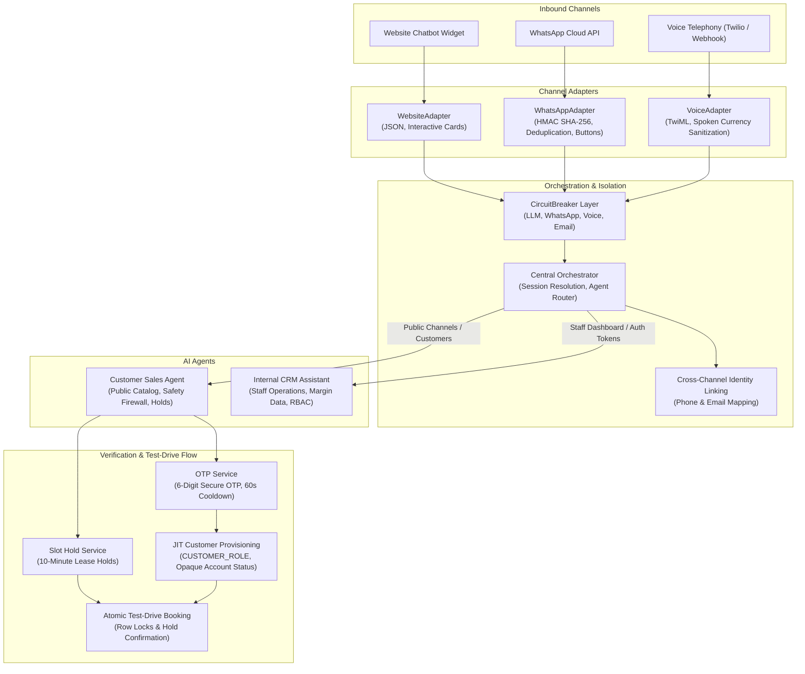

# Multi-Channel AI Agent Architecture

This document describes the multi-channel AI agent architecture implemented for DealerDesk. It extends the dealership CRM platform with autonomous conversational agents across Website, WhatsApp, and Voice channels while preserving strict isolation with the internal staff CRM assistant.

---

## 1. System Overview & Architecture

---

## 2. Logical AI Agent Roles

The architecture defines two distinct logical agent personas with strict access control:

| Dimension | Customer Sales Agent (`sales_agent_service.py`) | Internal CRM Assistant (`assistant_service.py`) |
| --- | --- | --- |
| **Audience** | Public customers, prospective car buyers | Dealership staff (Admins, Managers, Sales Reps) |
| **Channels** | Website Chatbot, WhatsApp Business, Voice Telephony | Dealership Staff Dashboard only |
| **Data Scope** | Public vehicle inventory, vehicle specs, public RAG knowledge (hours, warranties, policies) | Internal leads, margins, sales performance, staff management, private operational documents |
| **Safety & Deflections** | Automotive safety firewall (PII warnings, prompt injection defense, non-automotive deflection) | Role-based authorization gates (`STAFF_ROLES`), dealership workspace isolation |
| **Actions** | Inventory filtering, comparisons, temporary slot holds, OTP verification, lead capture | Staff analytics, document upload/indexing, internal scheduling, CRM operational workflows |

---

## 3. Channel Adapters

All channels are isolated into dedicated adapters in `app/adapters/` inheriting from `BaseChannelAdapter`:

### A. Website Chatbot Adapter (`WebsiteAdapter`)
- Inbound: Standard JSON payloads with `session_id` and customer message.
- Outbound: Structured JSON payloads containing `text`, `intent`, `cards` (vehicle cards with specs and prices), `slots` (available test-drive slots), and `actions` (quick replies).

### B. WhatsApp Business & Twilio Sandbox Adapter (`app/channels/whatsapp/` & `WhatsAppAdapter`)
- **Twilio Sandbox & Cloud API Support**: Compatible with both Twilio WhatsApp Sandbox (`whatsapp:+14155238886`) and Meta Cloud API webhooks.
- **TwiML Synchronous Generation**: Converts conversational agent responses into standard `<Response><Message>...</Message></Response>` TwiML XML to reply synchronously to incoming webhooks without requiring separate outbound API calls.
- **Outbound REST API Client**: `TwilioWhatsAppService` handles proactive messages and notifications via Twilio REST API (`client.messages.create`).
- **HMAC Signature Verification & Deduplication**: Validates inbound requests and tracks message IDs to reject duplicates over a 5-minute sliding TTL window.
- **Public Inbound Endpoints**: Mounted at `/api/v1/channels/whatsapp/webhook` (and root alias `/channels/whatsapp/webhook`) for easy integration with ngrok tunnels and production domain reverse proxies.

### C. Voice Telephony & Vapi Voice AI Adapter (`app/channels/vapi/` & `VoiceAdapter`)
- **Vapi Server URL Integration**: Full bi-directional integration with Vapi (vapi.ai) voice agents via `/api/v1/channels/vapi/webhook`.
- **Dynamic Assistant Provisioning**: Handles Vapi `assistant-request` events by injecting real-time dealership brand voice, system prompts, and function tools.
- **Real-Time Voice Function Tools**: Executes live database functions during phone calls:
  - `search_inventory`: Speech-friendly vehicle catalog search.
  - `get_vehicle_details`: Full specs and pricing for callers.
  - `get_available_test_drive_slots`: Formatted appointment openings.
  - `book_test_drive`: Real-time phone test-drive reservations.
  - `get_dealership_info`: Location, business hours, and warranty policies.
  - `capture_customer_lead`: Captures caller phone, name, and notes into CRM leads.
- **Automated CRM Sync**: Vapi `end-of-call-report` events automatically log call audio recordings, full transcripts, and AI summaries into the `conversations` and `customer_leads` tables.
- **Outbound Voice Calling**: Supports autonomous outbound calls to customers via Vapi REST API (`POST /api/v1/channels/vapi/call`).
- **Legacy Telephony Adapter**: `VoiceAdapter` provides native Twilio Voice / TwiML fallback with spoken price sanitization.

---

## 4. Central Orchestration Layer (`app/orchestration/orchestrator.py`)

The Central Orchestrator coordinates inbound channel traffic:
1. **Channel Identification & Event Normalization**: Converts diverse payloads into a uniform `ChannelEvent`.
2. **Session & History Segregation**: Tracks persistent channel conversations in the `conversations` table, preventing context bleed between customers.
3. **Cross-Channel Customer Linking**: Automatically resolves customer identities across different channels using verified phone numbers (`phone_{digits}@customer.dealerdesk.local`) and email addresses.
4. **Deterministic Routing**: Routes customer channels to the Sales Agent and authenticated staff dashboard origins to the CRM Assistant.

---

## 5. Customer Authentication & Test-Drive Verification Workflow

To prevent fake bookings, slot hoarding, and identity spoofing, test-drive scheduling enforces a strict 12-step verification flow:

1. **Slot Selection**: Customer selects an eligible test-drive slot.
2. **Availability Check**: System checks slot status, vehicle status, and capacity with database row-level locking (`SELECT ... FOR UPDATE`).
3. **Temporary Slot Hold Lease**: System places a 10-minute hold on the slot (`TestDriveSlotHold`), reducing available capacity without creating an unconfirmed booking.
4. **Customer Identification**: System requests customer contact info (email or phone).
5. **Cryptographic OTP Dispatch**: Generates a single-use 6-digit numeric OTP (`OTPVerification`) stored as a SHA-256 hash. Enforces a **60-second resend cooldown** and a **3-attempt maximum lockout**.
6. **Account Existence Privacy**: Verification initiation responses are completely opaque (`status: "otp_sent"`), never disclosing whether an account already exists for the email or phone number.
7. **Customer Submits OTP & Explicit Confirmation**: Customer provides the code and explicit booking confirmation (`confirmed: True`).
8. **Constant-Time Verification**: System checks the code hash; invalid attempts decrement remaining attempts; third failure permanently invalidates the token.
9. **JIT Account Provisioning**: If existing, the account is authenticated; if new, a verified customer user account (`CUSTOMER_ROLE`) is provisioned with a random Argon2-hashed password.
10. **Atomic Booking Creation**: System invokes `test_drive_service.book_slot(..., hold_token=hold_token)` in a database transaction, confirming the hold token and creating the permanent `TestDriveBooking`.
11. **Conversation Linking**: The active conversation session is linked to the customer user ID.
12. **Channel Receipt**: Confirmation message is delivered through the customer's active channel (Website card, WhatsApp confirmation, or Voice TwiML).

---

## 6. Fault Isolation & Reliability Architecture

The multi-channel architecture is engineered to prevent cascading failures:

- **Circuit Breakers (`CircuitBreaker`)**:
  - Independent thread-safe circuit breakers guard external dependencies: `llm_circuit_breaker`, `whatsapp_circuit_breaker`, `voice_circuit_breaker`, and `email_circuit_breaker`.
  - State transitions: `CLOSED` &rarr; `OPEN` (after 5 failures) &rarr; `HALF_OPEN` (30s recovery timeout probe).
- **LLM Outage Fallback**:
  - If the LLM provider experiences an outage or timeout, the Sales Agent catches the circuit breaker failure and executes `_synthesize_grounded_response`.
  - Generates a factual, grounded catalog response directly from database inventory records without throwing errors.
- **Channel Independence**:
  - Telephony or WhatsApp gateway errors return safe fallback responses without crashing the server or affecting other channels.
  - Core dealership management (vehicles, inventory, bookings, staff) remains **100% operational** even during complete external AI provider outages.
- **Webhook Deduplication & Idempotency**:
  - Duplicate webhook delivery retries are safely ignored at the adapter layer, preventing duplicate leads or duplicate bookings.

---

## 7. Multi-Channel API Reference

| Method | Endpoint | Description | Access |
| --- | --- | --- | --- |
| `POST` | `/api/v1/orchestration/dispatch` | Central event dispatch across any channel | Public / Internal |
| `POST` | `/api/v1/dealerships/{id}/channels/website/message` | Website chat widget inbound message | Public |
| `GET` | `/api/v1/dealerships/{id}/channels/whatsapp/webhook` | Meta WhatsApp Cloud API challenge verification | Public |
| `POST` | `/api/v1/dealerships/{id}/channels/whatsapp/webhook` | Meta WhatsApp inbound message webhook | Public |
| `POST` | `/api/v1/dealerships/{id}/channels/voice/webhook` | Telephony speech recognition webhook | Public |
| `POST` | `/api/v1/dealerships/{id}/sales-agent/chat` | Direct conversational turn with Sales Agent | Public / Customer |
| `POST` | `/api/v1/dealerships/{id}/sales-agent/chat/stream` | SSE streaming turn with Sales Agent | Public / Customer |
| `POST` | `/api/v1/dealerships/{id}/sales-agent/verification/initiate` | Holds slot and dispatches verification OTP | Public / Customer |
| `POST` | `/api/v1/dealerships/{id}/sales-agent/verification/confirm` | Verifies OTP and books test-drive | Public / Customer |
| `POST` | `/api/v1/dealerships/{id}/sales-agent/slot-holds` | Directly acquires a 10-minute slot hold lease | Public / Customer |
| `POST` | `/api/v1/dealerships/{id}/sales-agent/leads` | Captures sales lead from conversational turn | Public / Customer |
| `GET` | `/api/v1/dealerships/{id}/sales-agent/conversations/{id}/messages` | Retrieves conversation message history | Public / Customer |

---

## 8. Automated Test Coverage

The multi-channel AI architecture is validated by 34 comprehensive automated tests:

- `test_multi_channel_chaos_and_isolation.py` (5 tests): Cross-channel identity linking, session privacy, LLM provider outage circuit breaking, WhatsApp webhook deduplication, and voice provider isolation.
- `test_customer_verification_and_booking.py` (6 tests): End-to-end OTP flow, JIT user creation, opaque existence privacy, 60s cooldowns, 3-attempt lockouts, hold lease expiration, and API endpoints.
- `test_orchestration.py` (4 tests): Central event routing, agent selection, session isolation, and dispatch endpoint.
- `test_channel_adapters.py` (7 tests): Payload normalization, HMAC signature validation, TwiML generation, and speech pricing sanitization.
- `test_sales_agent.py` (7 tests): Inventory search, comparisons, slot holds, lead capture, and safety deflection firewall.
- `test_phase1_architectural_gaps.py` (5 tests): Circuit breaker state machines, atomic concurrency checks, and conversation persistence.
