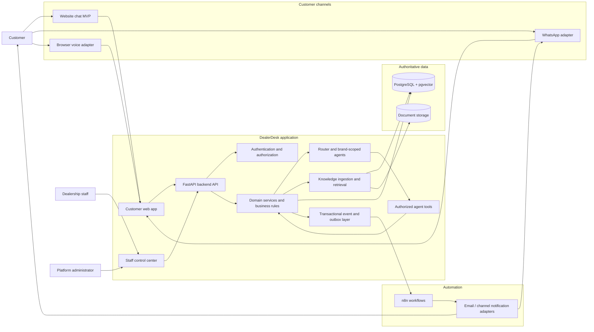
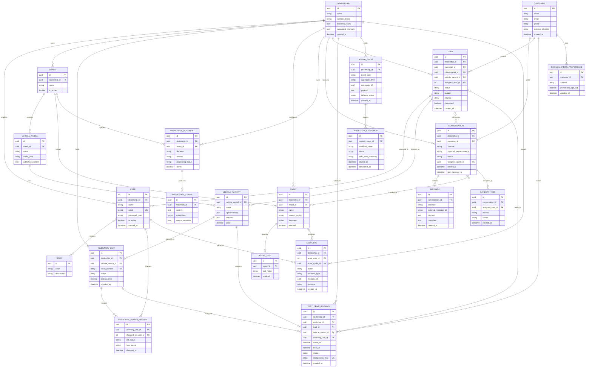
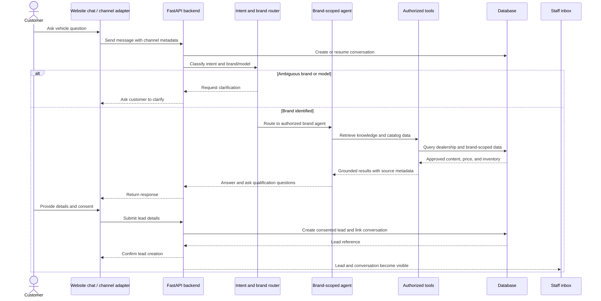
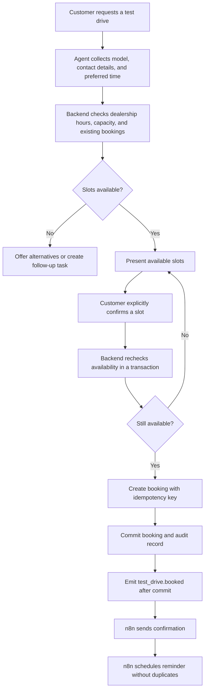
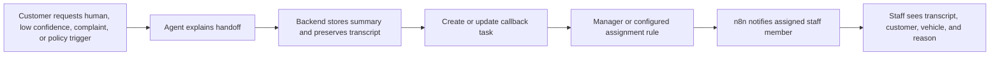
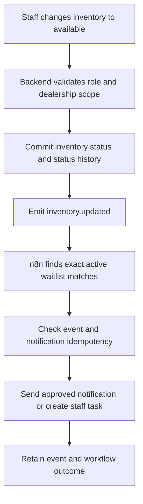
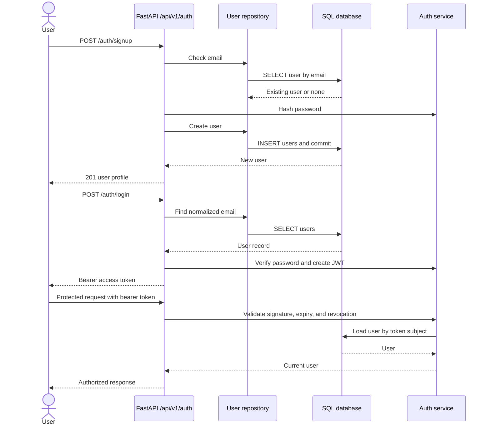

# DealerDesk System Architecture and Data Model

This document explains the planned DealerDesk / AutoPilot AI system from the
functional requirements and project execution plan. It is intentionally written
as a normal Markdown document so it can be read in GitHub, VS Code, or any
Mermaid-compatible Markdown viewer.

> **Implementation status:** The target model below describes Version 1
> requirements. The initial workspace phase now implements customer
> registration, dealership registration, dealership-admin creation, staff
> invitation records, vehicle management, test-drive settings, and
> idempotent slot generation. Chat, WhatsApp, voice, leads, bookings, and n8n
> automation remain later phases.

## 1. System at a glance

DealerDesk is a multi-tenant dealership platform with two main experiences:

1. **Customer experience:** a customer asks questions through website chat
   (MVP), receives grounded vehicle information, checks inventory, submits
   contact details, and books or changes a test drive.
2. **Staff control center:** dealership staff manage inventory, leads,
   conversations, agents, knowledge, bookings, workflows, and reports.

The backend is the source of truth. AI agents, channel adapters, and n8n
automation request operations from the backend; they do not own business state.

### Core ownership rules

| Area | Owner of truth | Important rule |
| --- | --- | --- |
| Users, roles, tenancy | Backend database | Every protected request checks role and dealership scope server-side. |
| Catalog and inventory | Backend domain services | Price and stock are read from backend data, never guessed by an agent. |
| Leads and bookings | Backend domain services | Writes are validated, transactional, auditable, and idempotent where needed. |
| Conversation history | Backend database | Messages retain channel, timestamps, external IDs, and conversation context. |
| Knowledge | Ingestion and retrieval services | Retrieval is filtered by dealership and brand. |
| Notifications and follow-up | n8n | n8n reacts to committed backend events and must be retry-safe. |
| AI providers | Provider adapters | LLM and embedding providers are replaceable and have mock implementations. |

## 2. Target entity relationship diagram

This is the logical Version 1 model implied by the functional requirements.
Foreign keys should include `dealership_id` on tenant-owned records, either
directly or through an owning entity, and queries must enforce that scope.

### Relationship interpretation

- One dealership owns its staff, brands, inventory, agents, knowledge, leads,
  conversations, bookings, events, and audit records.
- A brand belongs to one dealership. An agent and knowledge document may be
  scoped to a brand; this prevents cross-brand answers.
- A vehicle model has many variants, and each variant can have multiple stock
  units. Inventory status is one of `available`, `reserved`, `sold`, or
  `unavailable`.
- A conversation contains immutable message history and may produce a lead,
  booking, or human-handoff task.
- A booking may be associated with a lead and a specific inventory unit, but
  availability is ultimately validated against business hours, capacity, and
  existing bookings.
- A committed business change creates a domain event. n8n records its workflow
  result separately, allowing retries and operational visibility.

## 3. Main customer flow: inquiry to lead

## 4. Main customer flow: lead to test drive

The same transactional pattern applies to cancellation and rescheduling.
The backend, not the agent or n8n, decides whether the booking is valid.

## 5. Human handoff flow

## 6. Inventory waitlist flow

## 7. Authentication and request authorization

The current authentication flow is already present in the backend:

Current code locations:

- Application startup and router registration: `backend/app/main.py`
- Versioned API router: `backend/app/api/v1/router.py`
- Signup, login, logout, and current-user endpoints:
  `backend/app/api/v1/endpoints/auth.py`
- JWT and password operations: `backend/app/services/auth_service.py`
- User lookup and creation: `backend/app/repositories/user_repository.py`
- Current implemented SQLAlchemy model: `backend/app/models/user.py`

## 8. Current implementation versus target

| Capability | Current repository | Target described by requirements |
| --- | --- | --- |
| FastAPI app and versioned API | Implemented | Keep as API foundation |
| PostgreSQL database (Supabase/local) | Implemented | PostgreSQL + startup migrations + transaction pooler |
| User signup/login/logout/me & RBAC | Implemented | `dealerdesk_admin`, `dealership_admin`, `manager`, `sales_rep`, and `customer` |
| Dealership and staff management | Implemented | Workspace lifecycle, staff invitations, role revocation, last-admin guard |
| Brands and vehicle inventory | Implemented | Multi-brand support (up to 20), vehicle inventory CRUD, test-drive flags |
| Knowledge ingestion and retrieval | Implemented | PDF/text extraction, chunking, OpenAI-compatible or local embeddings, search |
| Test-drive slots and availability | Implemented | Timezone/DST slot generation, capacity tracking, remaining capacity, query filters |
| Test-drive bookings & management | Implemented | Concurrency locking, duplicate prevention, staff view/reschedule/cancel, customer verification |
| Website chat and conversations | Planned | Add channel adapters, messages, continuity, and consent |
| Agent routing and tools | Planned | Add router, brand agents, and narrow authorized tools |
| Leads management | Planned | Add lead capture, manual/round-robin assignment, and status lifecycle |
| n8n events and workflows | Planned | Add signed outbox events, retries, and workflow status |
| Staff control center and analytics | Planned | Add inbox, CRM, agent/knowledge management, and reporting |

### Initial workspace API

The initial phase exposes these backend operations under `/api/v1`:

- `POST /auth/signup` — creates a normal customer account.
- `POST /dealerships/register` — creates a dealership, its default
  test-drive settings, and the registering user as `dealership_admin`.
- `POST /dealerships/{id}/staff/invite` — creates a `manager` or `sales_rep`
  account scoped to the dealership with a pending activation record.
- `POST /auth/activate-invitation` — lets the invited staff member set a
  permanent password using the activation token.
- `POST/GET /dealerships/{id}/vehicles` — creates and lists dealership
  vehicles.
- `PUT /dealerships/{id}/test-drive-settings` — configures opening time,
  closing time, slot duration, capacity, and open weekdays.
- `POST /dealerships/{id}/test-drive-slots/generate` — creates missing slots
  for enabled vehicles in a requested date range; repeating the request does
  not duplicate slots.

Email delivery is intentionally isolated from account creation. The current
phase records `email_provider_pending` because no SMTP or external email
provider has been configured yet; it does not expose or log temporary
passwords. The next delivery step should connect the invitation activation
token to the configured email provider.

## 9. Recommended implementation order

The safest vertical slice is:

1. Add migrations and PostgreSQL-compatible models for dealership, roles,
   brands, vehicle variants, and inventory.
2. Add tenant and role authorization to the existing authentication flow.
3. Seed Honda and Toyota catalog data and expose read-only catalog/inventory
   APIs.
4. Add conversations and website chat persistence.
5. Add knowledge retrieval and brand-scoped agent routing.
6. Add lead creation, slot lookup, and transactional test-drive booking.
7. Add signed domain events and n8n confirmation/reminder workflows.
8. Add the staff control center, analytics, evaluation suite, and additional
   channel adapters.

This order follows the project plan's principle that one reliable
`chat -> grounded answer -> inventory -> lead -> booking -> notification`
journey is more valuable than many disconnected features.
